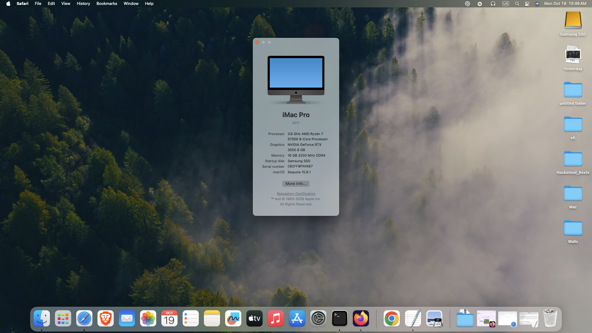
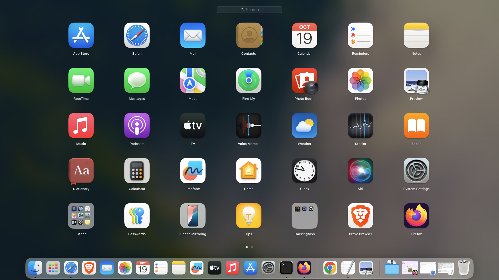
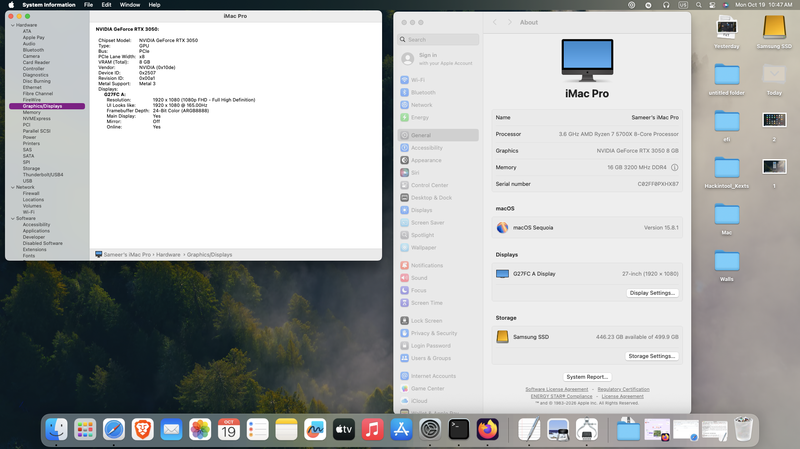
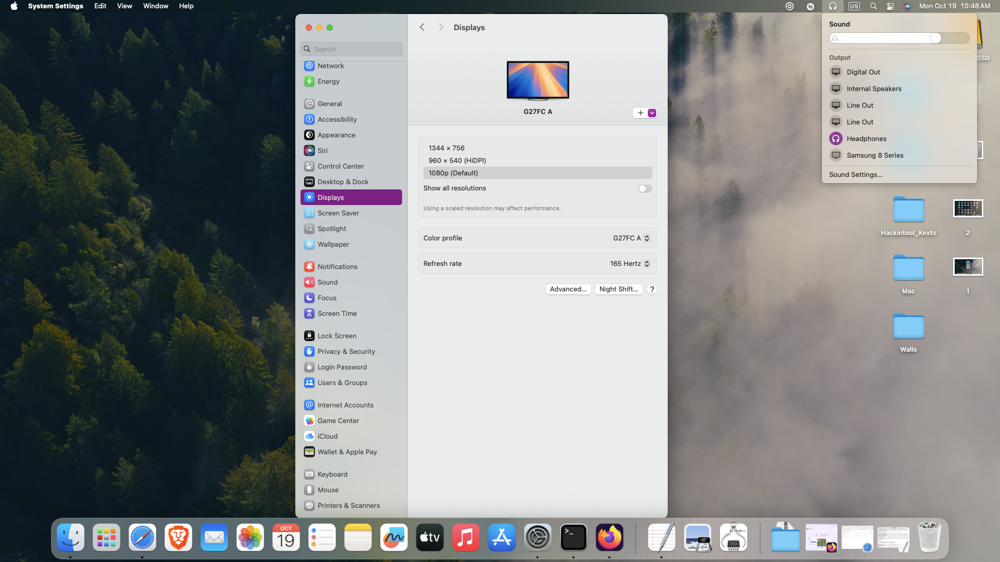

# Hackintosh: AMD Ryzen 7 5700X + ASUS TUF B550M-PLUS + NVIDIA RTX 3050 — macOS Sequoia

A working macOS Sequoia 15.8.1 build on an **AMD CPU + NVIDIA RTX GPU** (no iGPU, no Wi-Fi, no Bluetooth, Ethernet only),
using the community [nullmoth NVIDIA macOS driver](https://github.com/nullmoth/nvidia-macos-driver) for Metal acceleration.

> Not affiliated with Apple, NVIDIA or nullmoth. Personal/educational use. The driver is PolyForm Noncommercial.
> You must generate **your own SMBIOS** (serial, MLB, UUID, ROM). The EFI here has placeholders (`CHANGE_ME`).

## Hardware

| Part | Model |
|---|---|
| CPU | AMD Ryzen 7 5700X (8C/16T) |
| Board | ASUS TUF GAMING B550M-PLUS (non-WiFi version) |
| GPU | Zotac GeForce RTX 3050 8 GB, DisplayPort to a 165 Hz 1080p monitor |
| iGPU | none (the 5700X has none) — the GPU is the only display |
| Boot drive | Samsung 970 EVO Plus 500 GB NVMe |
| Extra | Toshiba 1 TB HDD (used first for install, then cloned off) |
| LAN | Realtek RTL8125 2.5GbE (onboard) |
| Wi-Fi / BT | none, Ethernet only |
| Other | NZXT fans/lighting (not controllable in macOS) |

### Which B550M-PLUS do you have?
ASUS sells the board both **with and without Wi-Fi**. Mine is the non-Wi-Fi one. The Wi-Fi version has an Intel AX-series
card, which needs the extra kexts in [Wi-Fi / Bluetooth](#wi-fi--bluetooth) below. The rest of this EFI is the same.

## Status (what I actually tested)

| Item | Status |
|---|---|
| OpenCore 1.0.8 boot, recovery, install | Works |
| Ventura install, in-place upgrade to **Sequoia 15.8.1** | Works |
| NVIDIA driver (RTX 3050 8 GB shown in About This Mac) | Works |
| 1080p @ **165 Hz**, smooth UI, window animations | Works |
| Clone to NVMe with SuperDuper! and boot from it | Works, very smooth |
| Safari, Firefox | Fine |
| Chrome / Brave | **Laggy** even though `chrome://gpu` shows green ticks (see below) |
| Onboard LAN (RTL8125) | Kext included (LucyRTL8125Ethernet); confirm on your unit |
| Analog audio | AppleALC `alcid=1`; try layouts 1/3/7/11 if silent |
| DisplayPort/HDMI audio | Not supported by the driver |
| NZXT lighting / fan control | Not available in macOS (use Linux/Windows + liquidctl, or set it in hardware) |
| iMessage / FaceTime | Needs your own valid SMBIOS; not covered here |
| Sleep/wake | Not tested; the driver notes it may return without GPU (`-nvrmnopm`) |

## Folders

- `EFI-Ventura-framebuffer-test/` — no NVIDIA driver, plain framebuffer. Use this first to prove the board/CPU boots.
- `EFI-Sequoia-NVIDIA/` — Sequoia + nullmoth driver settings (boot-args, SIP value, AMFIPass).
- `screenshots/` — `1.png` … `4.png` (my screenshots, see bottom).

## Steps

1. **BIOS** (ASUS, update first): CSM **off**, Above 4G Decoding **on**, Secure Boot off (clear keys), XHCI hand-off on,
   SATA AHCI, XMP off until it is stable. If you see ghost/black areas later, turn Resizable BAR off (driver issue #127).
2. **Download macOS** with OpenCore's `macrecovery`. For Sequoia use board `Mac-7BA5B2D9E42DDD94`, `-os latest`:
   `python3 macrecovery.py -b Mac-7BA5B2D9E42DDD94 -m 00000000000000000 -os latest download`
   (The default board gives Ventura/Tahoe.) Slow internet? Install Ventura first, then upgrade in place in System Settings.
3. **USB**: FAT32 (GUID/GPT), put the `EFI` folder at the root and `com.apple.recovery.boot` next to it.
4. **SMBIOS**: open `config.plist` in OpenCore Configurator / ProperTree, generate `iMacPro1,1` with GenSMBIOS/macserial and fill
   SystemSerialNumber, MLB, SystemUUID, ROM (your NIC MAC). Never post these.
5. **Install** (APFS, GUID). Boot from the USB each time until you copy EFI to the SSD's EFI partition.
6. **NVIDIA driver**: switch to `EFI-Sequoia-NVIDIA`, install the driver with the 1401 app (keep the USB in), reboot.
   Required settings are already in the config: boot-args `nvfb=1 nvaccel=1 nvfbheads=4 -nvkmsnosmooth amfi_get_out_of_my_way=0x1
   amfi=0x80 ipc_control_port_options=0`, `csr-active-config` `0x0A43`, SecureBootModel `Disabled`, Lilu + AMFIPass on.
   Enable `AMFIPass` only at this step. macOS 15 only.
7. **Move to NVMe**: Disk Utility "restore" does **not** make a bootable Sequoia clone. Use SuperDuper! (Backup – all files),
   grant Full Disk Access, quit every other app, then boot the new disk.

## AMD-specific notes
- Kernel patches are AMD_Vanilla; `cpuid_cores_per_package` is set to the core count (`08` for the 8-core 5700X).
  Change it for other CPUs (6 cores = `06`, 12 = `0C`, 16 = `10`).
- B550 quirks: `SetupVirtualMap` off, `DevirtualiseMmio` off, `RebuildAppleMemoryMap` on, `ProvideCurrentCpuInfo` on,
  `DummyPowerManagement` on, `XhciPortLimit` off. SSDTs: `SSDT-CPUR`, `SSDT-EC-USBX-DESKTOP`.
- NVMeFix helps the 970 EVO Plus. AppleMCEReporterDisabler avoids AMD MCE panics.

## Ethernet: RTL8111 vs RTL8125 (I got this wrong at first)
Many Realtek boards are **RTL8111**, but this board's onboard 2.5 GbE is **RTL8125**. Check yours:
`lspci -nn | grep -i ethernet` (Linux) → `10ec:8125` needs **LucyRTL8125Ethernet**, `10ec:8168` needs **RealtekRTL8111**.
Intel I225/I226 use a different kext (AppleIGC / SmallTreeIntel82576 variants). Don't ship both Realtek kexts. Use a USB
Ethernet adapter in Recovery if the onboard NIC is not up yet.

## Wi-Fi / Bluetooth
I use Ethernet only, so none of this is in my EFI. If your board has a card (e.g. the WIFI version of this board):
- **Intel Wi-Fi/BT**: `AirportItlwm` (pick the build for your macOS version) + `IntelBluetoothFirmware` + `IntelBTPatcher`, and
  `BlueToolFixup` on macOS 12+. You will also need to disable the native Apple Wi-Fi check as the guides describe. Continuity
  features (Handoff, Universal Clipboard, AirDrop) are not fully reliable on Intel cards.
- **Broadcom (Fenvi / supported cards)**: `AirportBrcmFixup` + `BlueToolFixup`. Best choice for iPhone ecosystem features.
- iMessage/FaceTime need your own SMBIOS and an Apple ID; Ethernet is fine for them. See the Dortania guides for Wi-Fi/BT.

## Chrome / Brave lag (open issue) (Maybe fixed in future)
`chrome://gpu` shows "Hardware accelerated", but Chrome 155 runs Skia Graphite on Dawn/Metal with ANGLE-Metal through the
driver's Metal→Vulkan translation, and feels laggy; Safari and Firefox are fine. Canvas shows "Software only" because of
Chrome's own NVIDIA-on-Mac blocklist. Things to test, one at a time: Graphite off (`chrome://flags/#skia-graphite`),
`--disable-gpu-compositing`, `NVMTL_ANGLE_METAL=0` (turns the driver rule off; Chrome may draw on the CPU).
Report it through the driver's issue tracker with the 1401 app's *Send logs* ID. Don't paste AI-written reports there.

## Screenshots
| | |
|---|---|
|  |  |
|  |  |

## Credits
Acidanthera (OpenCore, Lilu, VirtualSMC, AppleALC, NVMeFix, RestrictEvents), Dortania guide, AMD_Vanilla patches,
Mieze (LucyRTL8125), AMFIPass authors, nullmoth (NVIDIA driver), AnBui2004's B550M repo for reference.
